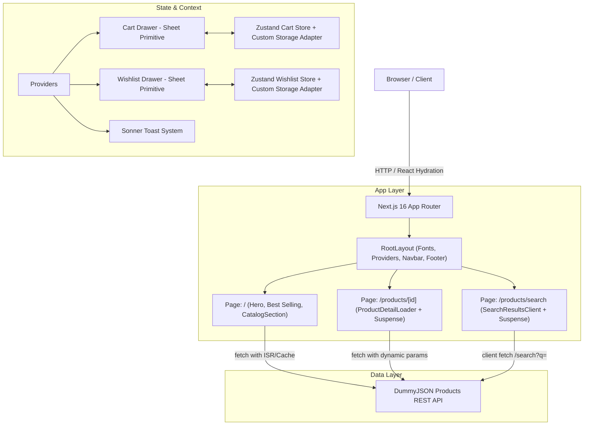

# Rive — Modern Luxury Minimalist Fashion E-Commerce

<div align="center">


<br />

**A production-ready, editorial-grade fashion storefront designed for luxury apparel brands.**  
*Bridging avant-garde lookbook aesthetics with modern React 19 server-streaming architecture.*

[Live Demo](#) · [Key Features](#key-features) · [Architecture & Design](#system-architecture) · [Getting Started](#getting-started)

</div>

---

## 📌 Executive Summary

**Rive** is an editorial-first e-commerce web application engineered to demonstrate senior-level frontend engineering, modern React paradigms, and high-conversion UI/UX design. Inspired by minimalist luxury fashion labels (such as Fear of God, Jacquemus, and Acne Studios), Rive translates high-fashion lookbook layouts into an interactive, high-performance web experience.

The application integrates dynamically with the **DummyJSON Products REST API**, featuring live catalog filtering, full-text search, dynamic product detail routing, interactive media galleries, and persistent client-side state for both cart and wishlist systems.

---

## ✨ Key Features & User Experience

### 1. Editorial Hero & Lookbook Gallery
- **Hero Statement**: High-contrast typography pairing an editorial serif (*Playfair Display*) with clean geometric sans-serif (*Plus Jakarta Sans*).
- **Arched Silhouette Carousel**: 5 rounded arch-topped model cards showcasing seasonal lookbook silhouettes with interactive navigation and subtle hover depth.
- **Top Announcement Countdown**: Real-time ticker banner featuring minutes/seconds countdown for flash collections and complimentary shipping incentives.

### 2. Live Dynamic Product Catalog
- **Category Filtering**: Seamless client & URL-synced category switching across fashion segments (`tops`, `mens-shirts`, `womens-dresses`, `womens-bags`, `sunglasses`, `mens-shoes`, etc.).
- **Multi-Criteria Sorting**: Sort products dynamically by Featured, Price (Low-to-High / High-to-Low), and Customer Rating.
- **Micro-Interactions & Hover Reveals**: Dual-image hover transitions displaying alternate garment angles without additional network roundtrips.
- **Robust State Handlers**: Custom skeleton pulse screens for loading states, graceful error boundaries with retry mechanisms, and zero-match empty states.

### 3. Instant Search Modal & Dedicated Search Page
- **Live Debounced Modal**: Global search accessible from any route with instant keystroke querying, trending keywords, and visual preview cards.
- **Dedicated Route (`/products/search?q=...`)**: Full-page search view with query refinement and sorting.

### 4. Dedicated Product Detail Pages (`/products/[id]`)
- **Interactive Stage**: Vertical thumbnail stack paired with a cursor-following zoom stage (`scale-150` with mouse coordinate origin tracking).
- **Commercial Customization**: Interactive color swatch pickers (*Taupe, Onyx Black, Heather Grey, Logan Moss*), size selectors (*XS to XXL*), and quantity steppers.
- **Rich Specifications**: Direct API mapping of SKU, package dimensions, weights, warranty terms, return policies, and verified customer reviews.
- **Algorithmic Recommendations**: "You May Also Like" carousel querying related garments within the same product category.

### 5. Shopping Bag & Wishlist Systems
- **Slide-out Cart Drawer (`shadcn/ui Sheet`)**: Built with `@radix-ui/react-dialog` primitives, featuring:
  - Dynamic **Free Shipping Progress Meter** (unlocks complimentary shipping at $100).
  - Quantity steppers (`+` / `-`) and item removal.
  - Subtotal, shipping, and order total calculations.
  - Mock secure checkout pipeline with loading states.
- **Wishlist Drawer**: Independent saved-items drawer allowing users to curate favorites and transfer them directly into the shopping bag with one click.
- **Persistent State**: Hydration-safe `localStorage` synchronization powered by Zustand with zero layout flash or SSR hydration mismatches.
- **Toast Notifications**: Context-rich feedback for all bag and wishlist actions powered by `sonner`.

---

## 🛠️ Technology Stack & Decisions

| Layer | Technology | Rationale |
|---|---|---|
| **Framework** | **Next.js 16 (App Router)** | Leverages React Server Components (RSC), Turbopack compilation, Partial Prerendering, and dynamic OpenGraph metadata generation. |
| **Language** | **TypeScript 5 (Strict)** | End-to-end type safety for API contracts, component props, and global store states. |
| **Styling** | **Tailwind CSS v4** | Next-gen CSS-first engine using `@theme inline` variables, modern OKLCH color palettes, and container queries. |
| **Components** | **shadcn/ui + Radix UI** | Accessible, unstyled headless primitives (Dialog, Sheet, Slot) customized into a bespoke minimalist luxury design system. |
| **State Management** | **Zustand 5** | Lightweight, boilerplate-free state stores with custom SSR-safe storage adapters for `localStorage`. |
| **Icons** | **Lucide React** | Clean, minimalist, tree-shakeable SVG iconography. |
| **Notifications** | **Sonner** | Performant, stackable toast system tailored with glassmorphism styling. |
| **Data Source** | **DummyJSON Products API** | 100% real REST API data consumed for catalog browsing, searches, pagination, and reviews. |

---

## 📐 System Architecture



### 🧩 Engineering Highlights & Problem Solving

1. **Hydration-Safe Persistent Stores**:  
   Default `localStorage` access during Next.js SSR causes hydration mismatches and prerender failures. Built a custom `customStorage` adapter with window guards and client-side mount checks, guaranteeing clean static prerendering and instant client hydration.

2. **React 19 & Next.js 16 Prerendering Harmony**:  
   Routes leveraging client hooks (`usePathname`, `useSearchParams`) were isolated into dedicated client components wrapped within `<Suspense>` boundaries, enabling Next.js 16's Partial Prerendering (PPR) engine to prerender static shell scaffolding while dynamically streaming user parameters.

3. **Responsive Fluid Gallery Zoom**:  
   Implemented an efficient mouse-coordinate tracking engine on the product detail stage (`origin-x / origin-y` calculation relative to bounding client rect) to provide an interactive magnify effect without heavy third-party canvas dependencies.

---

## 📁 Project Structure

```
rive-shop/
├── app/
│   ├── layout.tsx             # Root layout with fonts, SEO meta, Navbar, Footer & Providers
│   ├── page.tsx               # Homepage assembling Hero, Best Selling & Catalog
│   ├── globals.css            # Tailwind CSS v4 design tokens and theme variables
│   └── products/
│       ├── [id]/
│       │   └── page.tsx       # Dynamic product detail page (RSC + generateMetadata)
│       └── search/
│           ├── page.tsx       # Search page wrapper with Suspense boundary
│           └── SearchResultsClient.tsx # Client-side search & filtering engine
├── components/
│   ├── ui/                    # Headless primitives (Button, Sheet, Dialog, Badge, Input, etc.)
│   ├── Navbar.tsx             # Responsive header with countdown ticker & badge counters
│   ├── HeroSection.tsx        # Editorial lookbook hero with 5-arch model gallery
│   ├── CatalogSection.tsx     # Main catalog container with stateful pagination
│   ├── CategoryFilter.tsx     # Category pill slider, keyword filter & sorter
│   ├── ProductCard.tsx        # High-fashion product card with hover animations
│   ├── ProductGrid.tsx        # Grid layout with skeletons and error boundaries
│   ├── ProductGallery.tsx     # Vertical thumbnail stack & interactive zoom stage
│   ├── ProductDetail.tsx      # Comprehensive product specifications & purchase controls
│   ├── CartDrawer.tsx         # Slide-out shopping bag with free shipping meter
│   ├── WishlistDrawer.tsx     # Curated favorites drawer with quick-add actions
│   ├── SearchModal.tsx        # Debounced instant search modal
│   ├── Providers.tsx          # Client-side drawer and toast provider wrapper
│   └── Footer.tsx             # Editorial footer with VIP newsletter subscription
├── lib/
│   ├── api.ts                 # DummyJSON API client & helper methods
│   ├── store.ts               # Zustand stores for cart & wishlist with SSR-safe storage
│   └── utils.ts               # Class merging utility (cn)
├── types/
│   └── product.ts             # TypeScript definitions for Products, CartItems, Reviews
├── public/                    # Static assets
├── next.config.ts             # Next.js config with remote image patterns & cache rules
└── package.json               # Dependencies and scripts
```

---

## 🚀 Getting Started

### Prerequisites
- **Node.js**: `v20.x` or higher
- **npm**: `v10.x` or higher (or `pnpm` / `yarn`)

### Installation

1. **Clone the repository**:
   ```bash
   git clone https://github.com/your-username/rive-shop.git
   cd rive-shop
   ```

2. **Install dependencies**:
   ```bash
   npm install
   ```

3. **Start the local development server**:
   ```bash
   npm run dev
   ```

4. **Open your browser**:
   Navigate to [http://localhost:3000](http://localhost:3000) to view the application.

### Available Scripts

| Command | Description |
|---|---|
| `npm run dev` | Starts the Next.js development server with Turbopack |
| `npm run build` | Compiles an optimized production build with TypeScript checks |
| `npm run start` | Starts the production server |
| `npm run lint` | Runs ESLint across the codebase |

---

## 🔍 API Integration Details

All catalog data is fetched live from the [DummyJSON Products API](https://dummyjson.com/docs/products):

- `GET /products?limit={limit}&skip={skip}`: Paginated product list
- `GET /products/category/{category}`: Filtered products by category
- `GET /products/categories`: Category taxonomy
- `GET /products/search?q={query}`: Full-text search
- `GET /products/{id}`: Single product specifications, stock status, ratings, and reviews

---

## 🎨 Design System & Aesthetics

- **Color Palette**: Off-white canvases (`#ffffff`, `#fafafa`), Onyx Black accents (`#0a0a0a`), and neutral zinc midtones.
- **Corner Radii**: Generous pill curves (`rounded-full`, `rounded-[2rem]`, `rounded-[2.5rem]`) mimicking modern high-end architectural fashion lookbooks.
- **Motion**: Subtle micro-interactions, scale triggers on image hover, smooth slide transitions for drawers, and skeleton shimmering.

---

## 📄 License & Attribution

This project is open-source and available under the [MIT License](LICENSE).  
Developed as a demonstration of modern frontend architecture and senior-level e-commerce design.
