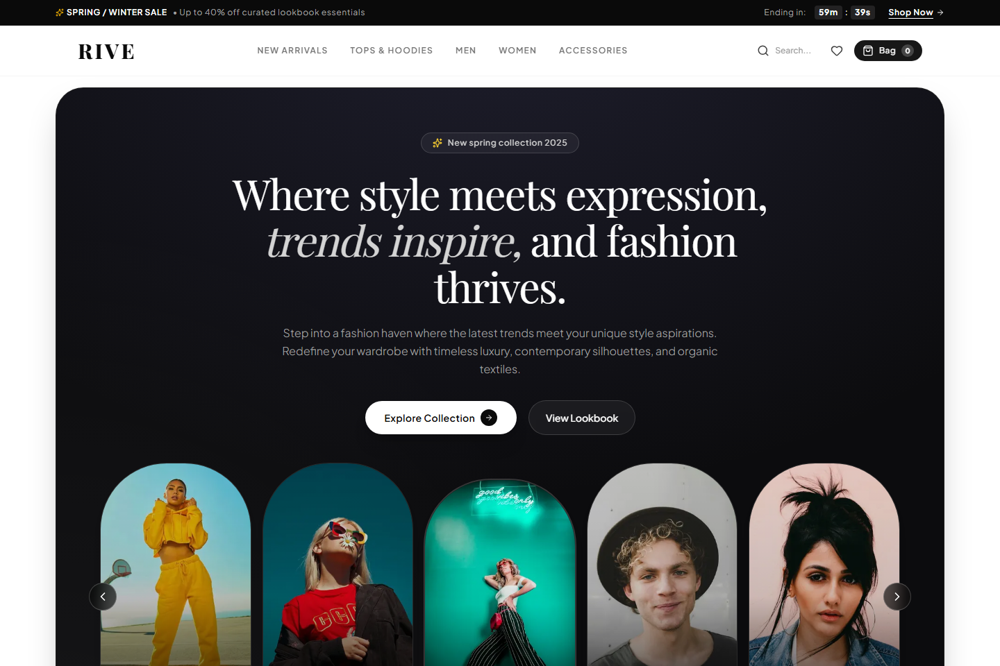
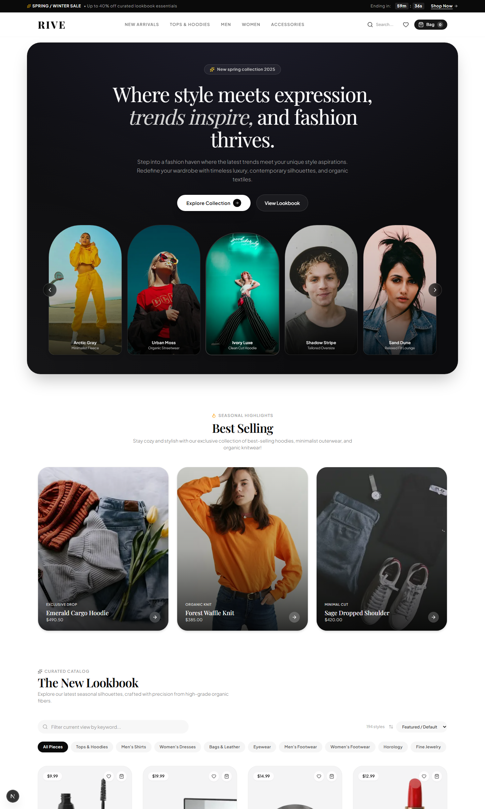
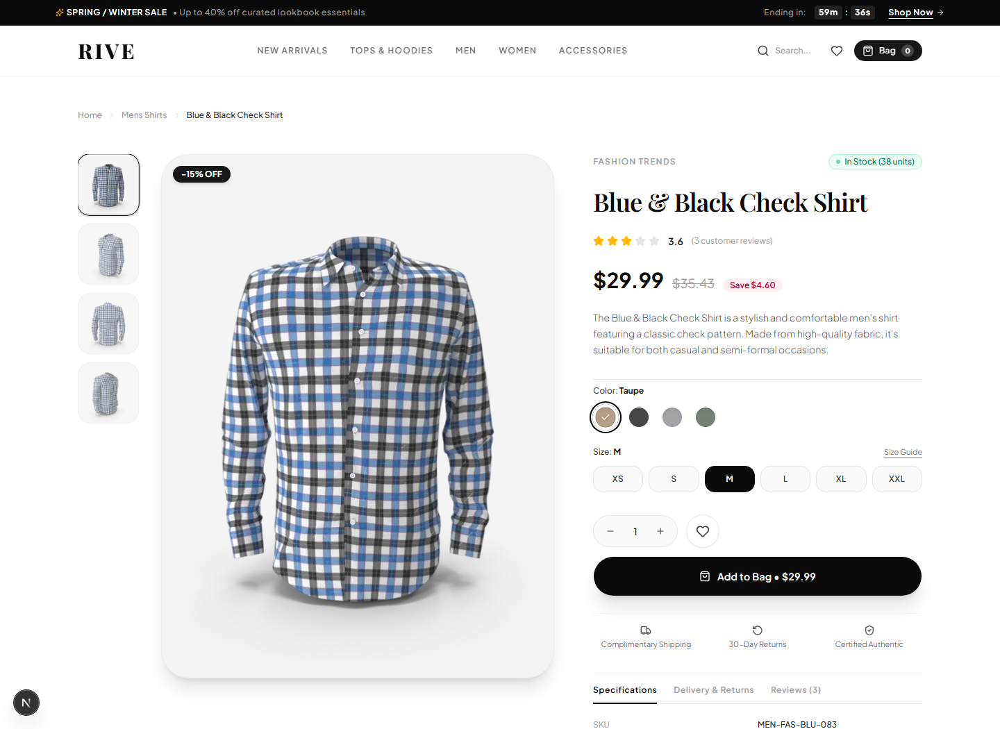
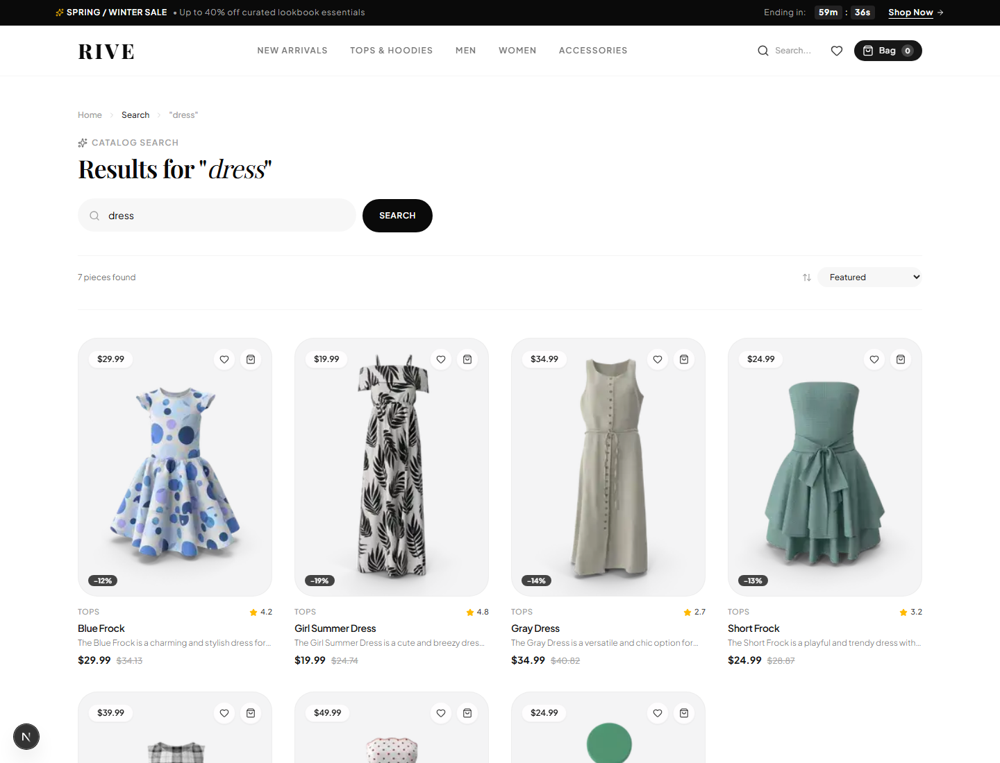
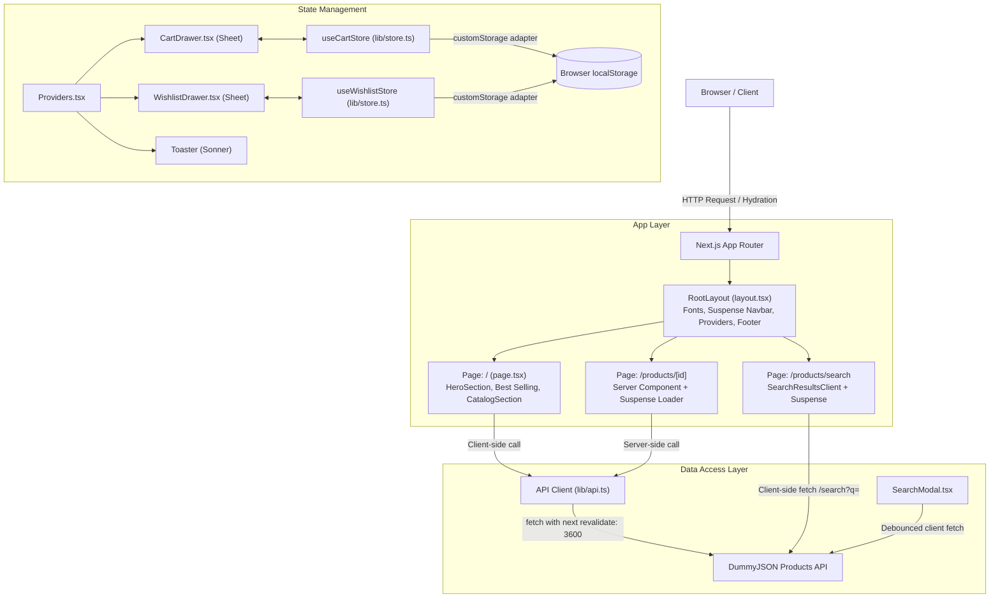

# Rive — Minimalist Fashion E-Commerce Frontend

<div align="center">


<br />

**A responsive, editorial-inspired fashion e-commerce frontend built with Next.js 16 App Router, React 19, and Tailwind CSS v4.**  
*Consumes the DummyJSON Products REST API with client-side state persistence for cart and wishlist.*

[Visual Showcase](#-visual-showcase) · [Key Features](#-key-features) · [System Architecture](#-system-architecture) · [Getting Started](#-getting-started)

</div>

---

## Overview

**Rive** is an exploratory frontend e-commerce web application inspired by contemporary fashion lookbooks. The project focuses on clean typography, responsive layouts, and modern frontend architecture using the Next.js App Router and React 19.

All product data is dynamically fetched from the public **[DummyJSON Products API](https://dummyjson.com/docs/products)**. The application implements core e-commerce interactions on the client side—including category filtering, debounced search, product detail pages, and slide-out drawers for cart and wishlist management with `localStorage` persistence.

> **Note on Scope**: This project is a frontend portfolio demonstration. While it consumes real REST API endpoints for product data, transactional features such as checkout, payment processing, and user accounts are simulated entirely in the frontend.

---

## 📸 Visual Showcase

<div align="center">

### Homepage & Editorial Lookbook Hero
*Featuring Playfair Display headings, countdown demonstration ticker, and a 5-card arch lookbook carousel.*



<br />

### Product Catalog & Category Filtering
*Category pill navigation synced with URL search parameters, sorting options, and dual-image hover transitions.*



<br />

### Dynamic Product Detail Page (`/products/[id]`)
*Server-rendered product views with dynamic OpenGraph metadata, vertical thumbnail selector, cursor-tracking image zoom, and API-driven specifications.*



<br />

### Catalog Search & Results (`/products/search`)
*Full-text search querying DummyJSON, display of matching results, and multi-criteria sorting.*



</div>

---

## ✨ Key Features

### 1. Homepage & Editorial Hero
- **Typography Pairing**: Serif headlines using Google Font *Playfair Display* combined with *Plus Jakarta Sans* for UI labels and body text.
- **5-Card Arch Carousel**: Interactive lookbook carousel displaying seasonal silhouettes with circular navigation controls.
- **Announcement Bar**: Promotional top banner with a client-side timer demonstration ticking down minutes and seconds.

### 2. Product Catalog & Filtering
- **Category Navigation**: Filters products by fashion categories (`tops`, `mens-shirts`, `womens-dresses`, `womens-bags`, `sunglasses`, `mens-shoes`, etc.) with URL query synchronization (`/?category=...#catalog`).
- **Sorting Options**: Sorts catalog items by Featured, Price (ascending / descending), and Customer Rating.
- **Image Hover Transition**: Product cards render primary thumbnails and secondary images from the API payload with a CSS opacity crossfade on hover.
- **Feedback States**: Includes skeleton loading cards, an error boundary with a manual retry button, and an empty state when filters yield no items.

### 3. Search Workflow
- **Search Modal**: Global search dialog with a 300ms debounce interval to avoid triggering API calls on every keystroke. Includes trending keyword suggestions.
- **Dedicated Search Route (`/products/search?q=...`)**: Full-page search view with live query input, result counts, and sorting.

### 4. Product Detail Experience (`/products/[id]`)
- **Server Component Route**: Product data is fetched on the server with Next.js dynamic OpenGraph metadata generation and a `<Suspense>` boundary around the data loader.
- **Interactive Gallery**: Thumbnail selector paired with a cursor-following zoom stage that dynamically updates CSS `transform-origin` based on mouse coordinates.
- **Interactive Selectors**: Color swatches (*Taupe, Onyx Black, Heather Grey, Logan Moss*) and apparel sizes (*XS to XXL*) provide client-side variant selection when adding items to the cart. *(Note: DummyJSON product records do not supply apparel variant matrices; variant options are handled on the frontend).*
- **API Specifications**: Displays real API fields including SKU, dimensions (width, height, depth), weight, shipping information, warranty terms, return policies, and sample API reviews.
- **Related Recommendations**: Displays a carousel of related items queried from the same product category.

### 5. Shopping Bag & Wishlist
- **Slide-out Drawers**: Cart and wishlist drawers built with Radix UI Dialog primitives (`@radix-ui/react-dialog`) and styled with Tailwind CSS.
- **Cart Controls**: Item quantity adjustment (`+` / `-`), item removal, and subtotal calculation.
- **Free Shipping Meter**: Visual progress indicator tracking progress toward a $100 free-shipping threshold.
- **Simulated Checkout**: Simulated checkout process with a loading delay and toast notification via Sonner; does not connect to a payment gateway.
- **Wishlist**: Quick-save toggle on product cards, saved items drawer, and one-click transfer of wishlist items into the shopping bag.
- **Persistence**: Store data is preserved across page refreshes via Zustand middleware with a custom browser storage adapter.

---

## 🛠️ Technology Stack & Decisions

| Technology | Version | Implementation Details |
|---|---|---|
| **Next.js** | `16.4.3` | App Router architecture. Uses React Server Components for product details and metadata, and client components for interactive catalog and drawer controls. |
| **React** | `19.3.0` | React 19 component model with `<Suspense>` boundaries wrapping dynamic client routes. |
| **TypeScript** | `5.9.3` | Configured with strict type checking (`strict: true`) across API interfaces, Zustand stores, and component props. |
| **Tailwind CSS** | `4.3.3` | Tailwind CSS v4 using `@theme inline` design tokens, custom font variables, and OKLCH color palettes in `globals.css`. |
| **shadcn/ui & Radix UI** | `1.8.1` | Headless, accessible dialog and sheet primitives (`@radix-ui/react-dialog`) customized for drawers and modals. |
| **Zustand** | `5.0.16` | Global state management for cart and wishlist stores using `persist` middleware and a custom storage wrapper. |
| **Sonner** | `2.0.8` | Toast notification system providing feedback for cart and wishlist updates. |
| **Lucide React** | `1.61.0` | Iconography across navigation, actions, and product badges. |
| **Turbopack** | Next.js built-in | Enabled by default in `next dev` and `next build` for fast local compilation. |
| **DummyJSON API** | REST API | Public REST endpoints providing real product catalog, category, search, and detail records. |

---

## 📐 System Architecture



### Technical Highlights

#### 1. Persistent State Management with Zustand
Cart and wishlist states are managed through separate Zustand stores configured with `persist` middleware in [`lib/store.ts`](lib/store.ts). To prevent server-side evaluation errors during Next.js prerendering, a `customStorage` adapter wraps browser `localStorage` calls with `typeof window !== "undefined"` guards:

```ts
const customStorage = {
  getItem: (name: string): string | null => {
    if (typeof window === "undefined") return null;
    try {
      return window.localStorage.getItem(name);
    } catch {
      return null;
    }
  },
  setItem: (name: string, value: string): void => {
    if (typeof window === "undefined") return;
    try {
      window.localStorage.setItem(name, value);
    } catch {}
  },
  removeItem: (name: string): void => {
    if (typeof window === "undefined") return;
    try {
      window.localStorage.removeItem(name);
    } catch {}
  },
};
```

Components that display storage-dependent numbers (such as badge counters in [`Navbar.tsx`](components/Navbar.tsx) and drawer contents in [`CartDrawer.tsx`](components/CartDrawer.tsx)) defer rendering count indicators until after initial client mount using a `mounted` state check, avoiding mismatch warnings between the server-rendered HTML and client state.

#### 2. Client Routing & Suspense Boundaries
In Next.js App Router, client components accessing dynamic URL data via `useSearchParams()` or `usePathname()` during static prerendering must be enclosed in `<Suspense>` boundaries. The application places `<Suspense>` wrappers around:
- The [`Navbar`](components/Navbar.tsx) in [`app/layout.tsx`](app/layout.tsx).
- The [`CatalogSection`](components/CatalogSection.tsx) in [`app/page.tsx`](app/page.tsx).
- The [`SearchResultsClient`](app/products/search/SearchResultsClient.tsx) in [`app/products/search/page.tsx`](app/products/search/page.tsx).
- The dynamic [`ProductDetailLoader`](app/products/[id]/page.tsx) in [`app/products/[id]/page.tsx`](app/products/[id]/page.tsx).

This separation ensures that surrounding layout elements and page shells can be served immediately while dynamic route parameters and search queries resolve.

#### 3. Cursor-Relative Image Magnification
The interactive zoom in [`components/ProductGallery.tsx`](components/ProductGallery.tsx) is implemented with pure CSS transforms and React event handlers:

```tsx
const handleMouseMove = (e: React.MouseEvent<HTMLDivElement>) => {
  const rect = e.currentTarget.getBoundingClientRect();
  const x = ((e.clientX - rect.left) / rect.width) * 100;
  const y = ((e.clientY - rect.top) / rect.height) * 100;
  setMousePos({ x, y });
};
```

When hovered, the image applies `scale-150` with an inline `transformOrigin: ${mousePos.x}% ${mousePos.y}%`, allowing the user to inspect garment textures smoothly without external canvas or zoom libraries.

---

## 📁 Project Structure

```
rive-shop/
├── app/
│   ├── layout.tsx             # Root layout with font loaders, Providers, Suspense Navbar & Footer
│   ├── page.tsx               # Homepage assembling HeroSection, Best Selling & CatalogSection
│   ├── globals.css            # Tailwind CSS v4 @theme inline tokens, OKLCH variables & base styles
│   ├── favicon.ico            # Site favicon
│   └── products/
│       ├── [id]/
│       │   └── page.tsx       # Dynamic product page (Server Component with generateMetadata)
│       └── search/
│           ├── page.tsx       # Search route wrapper with Suspense boundary
│           └── SearchResultsClient.tsx # Client-side search interface with query & sort state
├── components/
│   ├── ui/                    # Reusable headless UI primitives
│   │   ├── badge.tsx          # Badge component with custom styling variants
│   │   ├── button.tsx         # Button component based on class-variance-authority
│   │   ├── dialog.tsx         # Dialog primitive using @radix-ui/react-dialog
│   │   ├── input.tsx          # Styled input field
│   │   ├── separator.tsx      # Horizontal/vertical divider component
│   │   ├── sheet.tsx          # Slide-out Sheet drawer primitive
│   │   └── skeleton.tsx       # Loading placeholder skeleton component
│   ├── CartDrawer.tsx         # Slide-out shopping bag drawer with quantity controls & simulated checkout
│   ├── CatalogSection.tsx     # Main catalog container handling category filter state & pagination
│   ├── CategoryFilter.tsx     # Category pill buttons, in-catalog search input & sort dropdown
│   ├── Footer.tsx             # Editorial footer with brand links & mock newsletter form
│   ├── HeroSection.tsx        # Lookbook hero section with 5-card arch model carousel
│   ├── Navbar.tsx             # Navigation header with countdown demonstration banner & badge counters
│   ├── ProductCard.tsx        # Product grid card with dual-image hover transition & quick actions
│   ├── ProductDetail.tsx      # Detailed product view with swatches, size selectors, specs & reviews
│   ├── ProductGallery.tsx     # Image gallery with vertical thumbnail strip & cursor zoom stage
│   ├── ProductGrid.tsx        # Grid layout with loading skeletons, error & empty states
│   ├── Providers.tsx          # Client-side wrapper for CartDrawer, WishlistDrawer & Toaster
│   ├── SearchModal.tsx        # Global search modal with 300ms debounce timer & live previews
│   └── WishlistDrawer.tsx     # Slide-out wishlist drawer with quick-add to bag actions
├── lib/
│   ├── api.ts                 # DummyJSON API client functions (getProducts, getProductById, etc.)
│   ├── store.ts               # Zustand cart and wishlist stores with customStorage adapter
│   └── utils.ts               # Class name merging utility (cn)
├── types/
│   └── product.ts             # TypeScript interfaces for Product, CartItem, Category, API responses
├── public/
│   └── screenshots/           # Application preview images for documentation
│       ├── hero_preview.png
│       ├── catalog_preview.png
│       ├── product_detail.png
│       └── search_preview.png
├── components.json            # shadcn/ui configuration
├── eslint.config.mjs          # ESLint 9 configuration
├── next.config.ts             # Next.js configuration with remote image patterns & CSS rules
├── package.json               # Project dependencies and npm scripts
├── tsconfig.json              # TypeScript strict configuration
└── LICENSE                    # MIT License
```

---

## 🚀 Getting Started

### Prerequisites
- **Node.js**: `v20.x` or higher
- **npm**: `v10.x` or higher

### Installation

1. Clone the repository:
   ```bash
   git clone https://github.com/fatemedehghani/shop-ui.git
   cd shop-ui
   ```

2. Install dependencies:
   ```bash
   npm install
   ```

3. Start the local development server:
   ```bash
   npm run dev
   ```

4. Open your browser and navigate to:
   ```
   http://localhost:3000
   ```

### Available Scripts

| Script | Command | Description |
|---|---|---|
| `dev` | `npm run dev` | Runs the development server with Turbopack |
| `build` | `npm run build` | Compiles the production build with TypeScript verification |
| `start` | `npm run start` | Runs the compiled production server |
| `lint` | `npm run lint` | Runs ESLint checks across the repository |

---

## 🔍 API Integration Details

The application consumes public REST endpoints from the [DummyJSON Products API](https://dummyjson.com/docs/products):

| Endpoint | Method | Purpose in Application |
|---|---|---|
| `/products?limit={limit}&skip={skip}` | `GET` | Fetches default catalog products with limit/skip pagination in [`lib/api.ts`](lib/api.ts). |
| `/products/category/{category}` | `GET` | Fetches products filtered by category when a category pill is selected. |
| `/products/categories` | `GET` | Fetches available product category taxonomies. |
| `/products/search?q={query}` | `GET` | Performs text-based product searches in [`SearchModal.tsx`](components/SearchModal.tsx) and [`SearchResultsClient.tsx`](app/products/search/SearchResultsClient.tsx). |
| `/products/{id}` | `GET` | Fetches a single product record by ID on the server in [`app/products/[id]/page.tsx`](app/products/[id]/page.tsx). |

*Note: DummyJSON provides sample data intended for prototyping and demonstration. Stock counts, SKU numbers, dimensions, and customer reviews reflect the mock dataset provided by the API.*

---

## 🎨 Design System

- **Color Palette**: Neutral monochrome palette utilizing OKLCH variables in [`app/globals.css`](app/globals.css), based on pure white (`oklch(1 0 0)`), deep charcoal (`oklch(0.145 0 0)`), and warm neutral borders (`oklch(0.922 0 0)`).
- **Typography**: Dual-font typography system configured in [`app/layout.tsx`](app/layout.tsx) via `next/font/google`:
  - `Playfair Display`: High-contrast serif applied to editorial headings.
  - `Plus Jakarta Sans`: Geometric sans-serif applied to body text, inputs, and UI buttons.
- **Layout & Spacing**: Responsive grid layouts (`grid-cols-1 sm:grid-cols-2 md:grid-cols-3 lg:grid-cols-4`) bounded by `max-w-7xl` containers with fluid padding.
- **Border Radius**: Pill shapes (`rounded-full`) for buttons, search inputs, and badges; generous curved corners (`rounded-[1.75rem]` and `rounded-[2rem]`) for product cards and the lookbook hero.
- **Interactions**: CSS opacity crossfades on product cards, animated drawer slides via Radix UI presence states, and pulse animations for loading skeletons.

---

## 📄 License

This project is open-source and available under the [MIT License](LICENSE).  
Built by [Fatemeh Dehghani](https://github.com/fatemedehghani) as a frontend e-commerce portfolio project.
